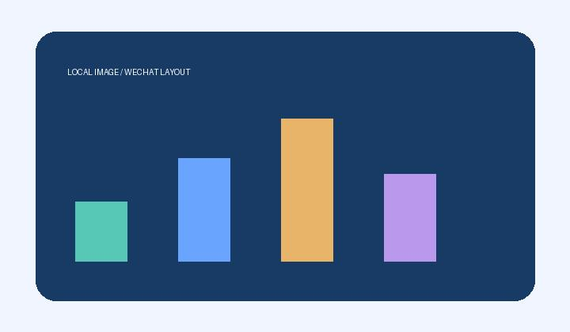

# 日常图文测试

大家好，这是一篇用于验证**公众号图文排版**的测试文章。这里有一张行内表情 ![[表情.png|24]]，它应当紧接文字。

## 本地图片与短段落

先检查带中文、空格的图片路径。

![[图片 空格/配图.png|480]]

同一张图片再次出现，可以设置不同的显示宽度：

![[图片 空格/配图.png|280]]

下面是 JPEG 照片和静态 WebP。

![[静态.webp]]

> 引用中也有图片：
> ![[一/同名.png|320]]

- 列表里保留文字和图片。
- ![[二/同名.png|240]]

## 动图与文末模块

![[动画.gif|160]]

*图源：本地生成的测试图。*

### 往期推荐

示例推荐文字，不包含真实跳转地址。

**保存草稿并重新打开后，请核对图片数量、顺序和动图效果。**
